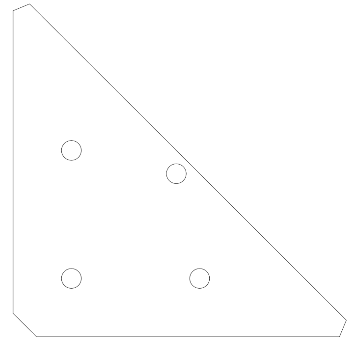
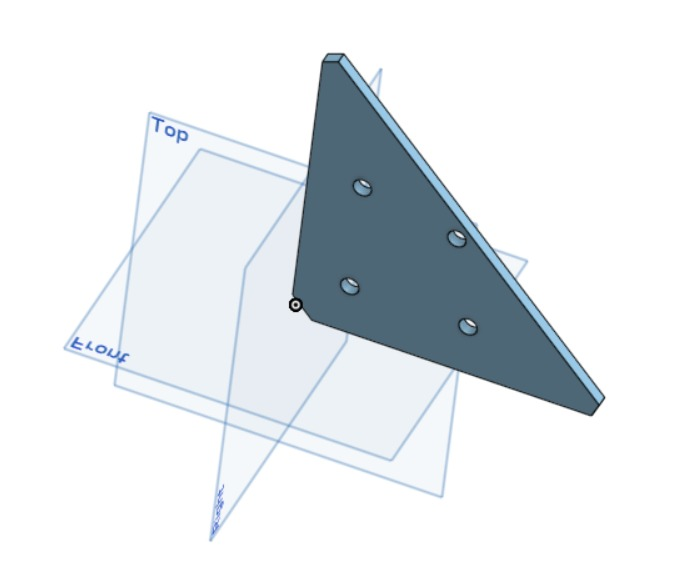

VERSION FRANÇAISE

Phase 1 : Modélisation 3D (CAO) sous Onshape 
Après avoir validé l'analyse fonctionnelle sur papier (Phase 0), l'ingénieur passe à la création virtuelle de la pièce. Cette étape consiste à traduire le croquis manuel en un modèle numérique tridimensionnel parfait robuste et sans erreur.

La méthodologie :
Pour concevoir une pièce dans les règles de l'art industrielles, on applique une logique en 4 étapes :
A. L'ANCRAGE À L'ORIGINE : Toute esquisse doit démarrer sur le point de repère fixe du logiciel (0,0). Cela permet de verrouiller la pièce dans l'espace et d'éviter qu'elle ne flotte. 
B. LA MODÉLISATION CONTRAINTE : On applique des dimensions (cotes) et des règles géométriques (perpendicularité, parallélisme). L'esquisse doit passer du bleu (instable) au noir (entièrement contrainte et verrouillée).
C. L'EXTRUSION (Passage à la 3D) : On donne du volume à la forme plane en appliquant l'épaisseur nominale spécifiée par le matériau brut.
D. LA GÉNÉRATION DES LIVRABLES : Un modèle 3D seul ne suffit pas en usine. Il faut exporter les fichiers sources universels (.STEP pour la FAO/usinage), les plans de fabrication normés (.PDF pour le réglage et la métrologie) et les profils de découpe (.DXF pour la découpe). 
Application au projet 01 : le gousset d'assemblage
A. L'ANCRAGE À L'ORIGINE :
Étape 1 : Création du document  
Cliquez sur le bouton bleu Créer en haut à gauche de l'écran, puis sélectionnez Document
Nommez le document : Gousset_Jonction_Structurelle
B. LA MODÉLISATION CONTRAINTE
Étape 2 : L'Esquisse 2D du profil triangulaire
Dans le panneau de gauche (l'arbre de construction), sélectionnez le plan Dessus (Top), puis cliquez sur le bouton Esquisse.
Appuyez sur la touche N de votre clavier pour mettre la vue parfaitement à plat.
Sélectionnez l'outil Ligne :
Cliquez une première fois sur le point central orange (l'Origine).
Glissez vers la droite et cliquez pour tracer la base horizontale.
Glissez vers le haut et cliquez pour tracer le côté vertical.
Cliquez à nouveau sur l'Origine pour fermer le triangle rectangle.
Sélectionnez l'outil Coter :
Cliquez sur la ligne horizontale, tapez 150 mm.
Cliquez sur la ligne verticale, tapez 150 mm.
Vérification : Toutes les lignes du triangle passent du bleu au noir. L'esquisse est 100 % contrainte.
Étape 3 : Cassure des angles (Chanfreins d'esquisse)
Dans la barre d'outils, cliquez sur la petite flèche noire à côté de l'outil Congé d'esquisse et sélectionnez Chanfrein d'esquisse.
Cliquez successivement sur les 3 sommets (les pointes) du triangle.
Tapez la valeur de 10 mm pour valider la taille du chanfrein à 45°.
Étape 4 : Positionnement des 4 perçages ∅ 8,5 mm 
Sélectionnez l'outil Cercle par son centre et dessinez 4 cercles à l'intérieur du triangle.
Sélectionner l'outil Coter :
Cliquez sur le bord de chaque cercle et réglez leur diamètre à 8,5 mm.
Verrouillez les positions par rapport à l'Origine et aux bords de référence :
Trou N°1 : Centre à 25 mm du bas et 25 mm de la gauche
Trou N°2 : Centre à 25 mm du bas et 80 mm de la gauche
Trou N°3 : Centre à 80 mm du bas et 25 mm de la gauche
Trou N°4 : Centre à 70 mm du bas et 70 mm de la gauche
Validez l'esquisse complète en cliquant sur l'encoche verte (✓).
C. L'EXTRUSION (Passage à la 3D) :
Étape 5 : Extrusion du volume (Passage en 3D) 
Dans la barre d'outils supérieure, cliquez sur l'outil Extrusion (icône de cube).
Cliquez sur la surface plate du gousset (en dehors des 4 trous).
Dans la case Profondeur, entrez 6 mm.
Validez en cliquant sur l'encoche verte (✓). Le modèle 3D apparaît à l'écran.
D. LA GÉNÉRATION DES LIVRABLES :
Étape 6 : Exportation des fichiers de fabrication
Exportez le modèle au format .STEP (3D universel)
Exportez la mise en plan normalisée au format .PDF ISO
Exportez le profil de coupe 2D au format .DXF

Check-list de validation CAO (vérification avant de valider son travail et de passer à l'étape suivante) 
* [ ]  Esquisse 100 % noire : Aucune ligne bleue résiduelle (géométrie entièrement contrainte).
* [ ]  Intégrité des perçages : Les 4 trous sont bien débouchants et font un diamètre de ∅ 8,5 mm.
* [ ]  Fichier STEP exporté : Modèle 3D universel généré.
* [ ]  Plan PDF ISO généré : Mise en plan A4 complétée avec le cartouche de l'école.

ENGLISH VERSION

 Phase 1: 3D CAD Modeling in Onshape

After validating the functional requirements analysis on paper (Phase 0), the engineer transitions to the virtual creation of the component. This step consists of translating the manual sketch into a flawless, robust, and error-free three-dimensional digital model.

The Methodology:
To design a component according to strict industrial standards, a 4-step logic is applied:
A. ANCHORING TO THE ORIGIN: Every sketch must originate from the software's fixed datum point (0,0). This locks the part in space and prevents geometric drifting.
B. PARAMETRIC & CONSTRAINED MODELING: Dimensions (constraints) and geometric relations (perpendicularity, parallelism) are applied. The sketch must turn from blue (under-constrained) to black (fully constrained and locked).
C. EXTRUSION (Transition to 3D): Volume is added to the 2D planar profile by applying the nominal thickness dictated by the raw material specifications.
D. DELIVERABLES GENERATION: A 3D model alone is insufficient for the shop floor. Universal source files (`.STEP` for CAM/machining), standard manufacturing blueprints (`.PDF` for setting up and metrology), and vector cutting layouts (`.DXF` for cutting) must be exported.
Application to Project 01: The Gusset Plate
A. ANCHORING TO THE ORIGIN:
Step 1: Document Creation
Click the blue **Create** button in the top left corner, then select **Document**.
Name the document: `Gousset_Jonction_Structurelle`.
B. PARAMETRIC & CONSTRAINED MODELING:
Step 2: 2D Sketching of the Triangular Profile
In the left-hand panel (the feature tree), select the **Top** plane, then click the **Sketch** button.
Press the `N` key on your keyboard to orient the view perfectly normal to the plane.
Select the **Line tool**:
Click first on the orange center point (the Origin)
Drag to the right and click to draw the horizontal base
Drag upward and click to draw the vertical side.
Click back on the Origin to close the right-angled triangle.
Select the **Dimension tool**:
Click the horizontal line, type `150 mm`.
Click the vertical line, type `150 mm`.
Verification: All lines of the triangle turn from blue to black. The sketch is 100% fully constrained.
Step 3: Corner Breaking (Sketch Chamfers)
In the toolbar, click the small black arrow next to the **Sketch Fillet** tool and select **Sketch Chamfer**.
Click sequentially on the 3 vertices (corners) of the triangle.
Enter a value of `10 mm` to validate the 45° chamfer size. 
Step 4: Placement of the 4 Through-Holes ∅ 8.5 mm
Select the **Center point circle tool** and draw 4 circles inside the triangle.
Select the **Dimension tool**:
Click the edge of each circle and set their diameter to `8.5 mm`
Lock their positions relative to the Origin and reference edges:
Hole N°1: Center at `25 mm` from the bottom and `25 mm` from the left.
Hole N°2: Center at `25 mm` from the bottom and `80 mm` from the left.
Hole N°3: Center at `80 mm` from the bottom and `25 mm` from the left
Hole N°4: Center at `70 mm` from the bottom and `70 mm` from the left
Validate the complete sketch by clicking the green checkmark (`✓`)
C. EXTRUSION (Transition to 3D):
Step 5: Solid Volume Extrusion (Transition to 3D)**
In the top toolbar, click the **Extrude tool** (cube icon).
Click the flat surface of the gusset plate (outside of the 4 holes).
In the **Depth** field, enter `6 mm`
Validate by clicking the green checkmark (`✓`). The 3D model appears on screen.
D. DELIVERABLES GENERATION:
Step 6: Manufacturing Deliverables Export
Export the model in `.STEP` format (universal 3D)
Export the standardized 2D drawing in `.PDF` ISO format
Export the 2D cutting profile in `.DXF` format

CAD Validation Checklist (Verification before validating work and moving to the next step)
* [ ] 100% Black Sketch: No residual blue lines (geometry fully constrained).
* [ ] Hole Integrity: All 4 holes are properly through-cutting and measure a diameter of ∅ 8.5 mm.
* [ ] STEP File Exported: Universal 3D model generated.
* [ ] ISO PDF Blueprint Generated: A4 engineering drawing completed with school title block.

